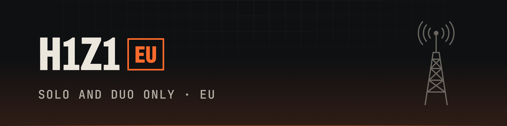
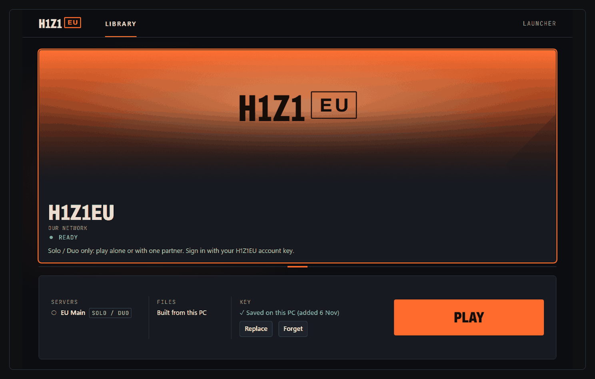
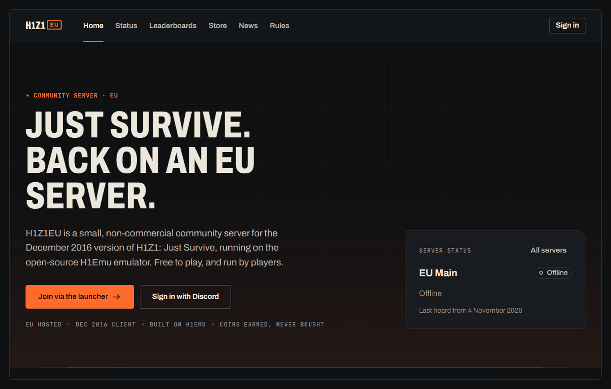
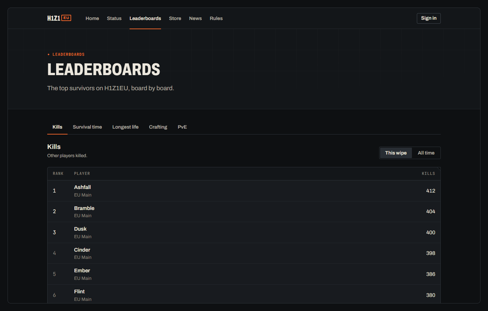
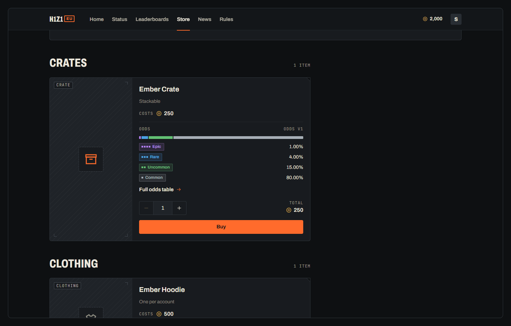
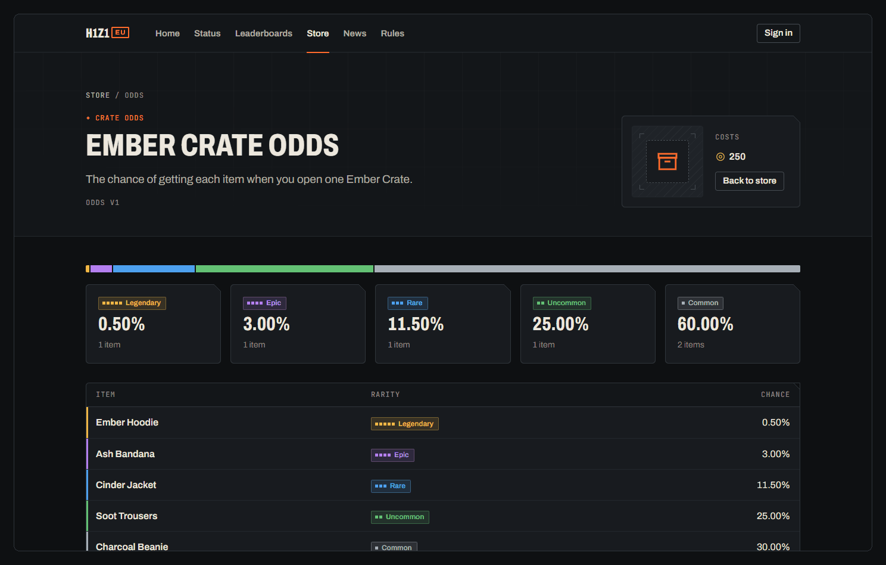
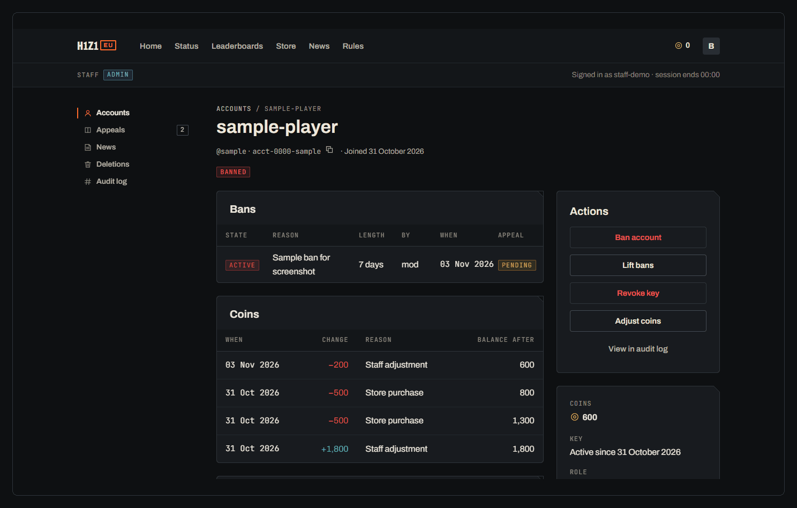
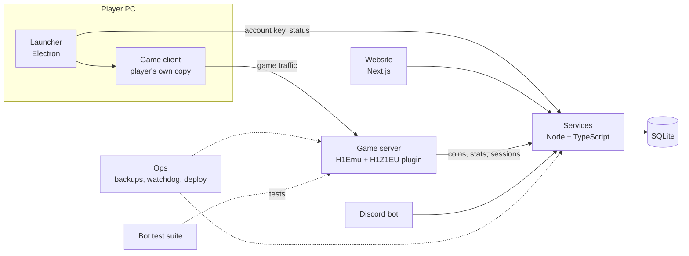

  <picture>
    <source media="(prefers-color-scheme: dark)" srcset="assets/banner-dark.png">
    <source media="(prefers-color-scheme: light)" srcset="assets/banner-light.png">
    
  </picture>

A solo and duo server for H1Z1: Just Survive, hosted in Europe and built on H1Emu. Groups of two at most.

  
  
  
  
  
  

> This repository holds documentation and screenshots. Source code will be published here in stages. There is no public server yet.

## What it is

H1Z1EU is a small, non-commercial community server for the December 2016 version of H1Z1: Just Survive, aimed at players in Europe. It is built for players on their own or in pairs: the largest group allowed is two. Coins are earned by playing, every crate shows its odds, and nothing can be bought with money. We run it on the open-source H1Emu emulator, with our own plugin, launcher, website and tooling around it.

## Who it's for

H1Z1EU is for people who want to play Just Survive alone or with one other person, without being run over by large groups.

**Why solo and duo.** Most servers end up decided by whoever has the biggest group. Capping groups at two keeps fights, raids and the leaderboards about what one or two players can do. Group size, base and lock access, leaderboards, challenges and moderation are all designed around that limit.

The anti-teaming principle, in short:

- Play alone or with one partner. Two is the maximum.
- Three or more players working together breaks the rules, whether or not they call it a group. Pairs teaming with other pairs, or with solo players, counts too.
- Bases, locks and shared storage are for you and your partner only.
- Staff will act on teaming reports.

The full rules, including how teaming is judged and what happens when it is found, will be published before launch.

## Screenshots

Development build with sample data. Names, costs and odds are placeholders.

<table>
  <tr>
    <td width="50%" valign="top"> Launcher: sign in with an account key, then play.</td>
    <td width="50%" valign="top"> Website home (development build): what the server is and how to join.</td>
  </tr>
  <tr>
    <td width="50%" valign="top"> Leaderboards by wipe or all time. Separate solo and duo boards are planned.</td>
    <td width="50%" valign="top"> Store: coins earned by play, crates with odds.</td>
  </tr>
  <tr>
    <td width="50%" valign="top"> Crate odds: every chance listed and versioned.</td>
    <td width="50%" valign="top"> Admin: accounts, appeals, news and an audit log (sample data).</td>
  </tr>
</table>

## What's in the project

| Part | What it does |
|---|---|
| Server | H1Emu 0.50.0 with a small patch set and a plugin that adds our solo and duo rules and features. |
| Services | A Node and TypeScript API over SQLite for accounts, coins, the store, crates, leaderboards and bans. |
| Launcher | An Electron app that signs players in and starts their own copy of the game. |
| Website | Sign-in, status, leaderboards, the coin store, news and an admin panel. |
| Bot tests | A protocol-level bot suite that plays through the real login and zone code, so changes are tested without a person. |
| Ops | Backups with a restore drill, a watchdog, staged releases, a Linux deploy path with rollback, and licence checks. |

See the [feature list](docs/FEATURES.md).

## Architecture

Players launch their own game client through the launcher. The H1Emu server, extended by our plugin, runs the world. A small services layer owns accounts, coins, stats and crate odds, and the website and Discord bot read from it. Ops tooling handles backups and restarts, and the bot suite tests server behaviour before changes ship. More in the [architecture notes](docs/ARCHITECTURE.md).

## Fair play

- Groups of two at most; teaming beyond that breaks the rules.
- Coins are earned by playing.
- Coins can't be bought, and nothing can be bought with money.
- Coins and items can't be sold, swapped or withdrawn.
- Every crate shows its odds, with a version number.

See the [fair-play policy](docs/FAIR-PLAY.md).

## Roadmap

Now: challenges and a free-track battlepass earned by play, loot tuning for solo and duo play, and a real-client QA bot. Next: separate solo and duo leaderboards, the group-size cap with partner-only base and lock access, ravens (in-game messages), a repair box, backpack and in-game inventory, scrap and a dressing room. Before launch: the full solo and duo rules. Later: a small private beta and publishing source for the parts we choose. See the [roadmap](docs/ROADMAP.md). Order may change; no dates are promised.

## Credits and licence

H1Z1EU runs on [H1Emu](https://github.com/QuentinGruber/h1z1-server) (GPL-3.0), and the launcher is forked from the JSEmu launcher (GPL-3.0). Documentation and screenshots here are under [CC BY 4.0](LICENSE); the H1Z1EU name, wordmark and emblem are reserved. See the [notice](NOTICE.md) and the [credits](docs/CREDITS.md).

H1Z1 is a trademark of Daybreak Game Company. H1Z1EU is not affiliated with Daybreak. No game files are included or distributed here.

## Community

Community links (Discord and website) will be added here when they open.
