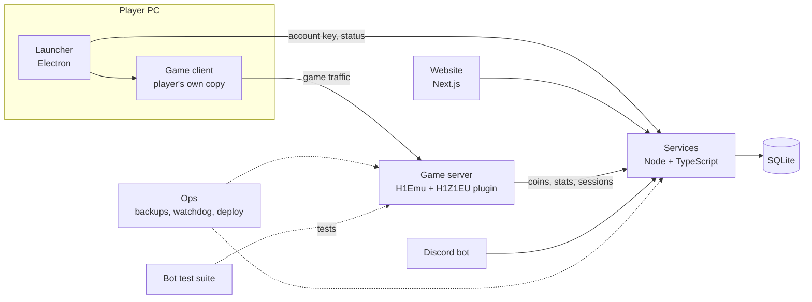

# Architecture

## Parts

| Part | What it is |
|---|---|
| Game server | [H1Emu](https://github.com/QuentinGruber/h1z1-server) 0.50.0, with a small set of patches and a plugin that adds our rules and features. |
| Services | A Node 24 and TypeScript API over SQLite. It owns accounts, coins, the store, crate odds and rolls, leaderboards and bans. |
| Launcher | An Electron app. It signs players in with their account key, gets a launch ticket and starts their own copy of the game. |
| Website | A Next.js site for sign-in, status, leaderboards, the coin store with published crate odds, news and an admin panel. It only talks to the services API. |
| Discord bot | Posts server status and staff notices from the services data. |
| Ops | Backups with a restore drill, a watchdog, staged releases, a Linux deploy path with rollback, and licence checks. |
| Bot test suite | Bot players that log in through the real login and zone code and check what the server does, so changes can be tested without a person playing. |

## How a session flows

1. A player signs in on the website and gets an account key.
2. The launcher asks services for a short-lived launch ticket and starts the game.
3. The login server accepts only a valid ticket. The zone server accepts only a zone token for the player's own character.
4. While they play, the server reports stats and coins to services. The website and leaderboards read the same data.

## Design rules

- The website never touches the game database. Everything goes through services.
- Coins are earned by playing. Nothing sells coins or crates for money, and there is no cash-out.
- A crate can't be sold until its odds are published. Every roll is logged and can be replayed.
- Keys, tickets and tokens are never logged or put in URLs.
